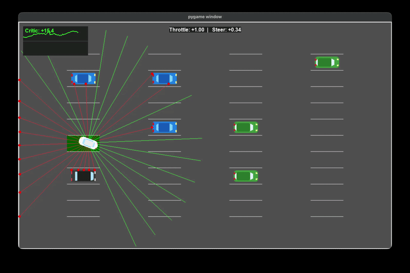
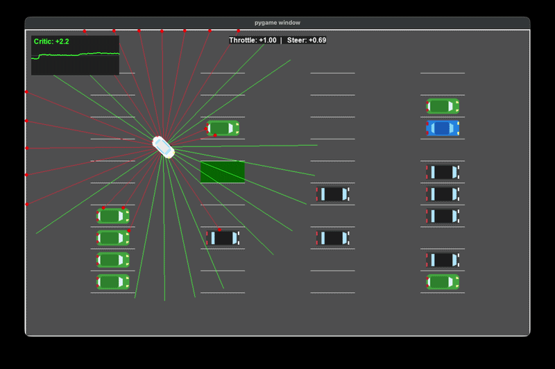
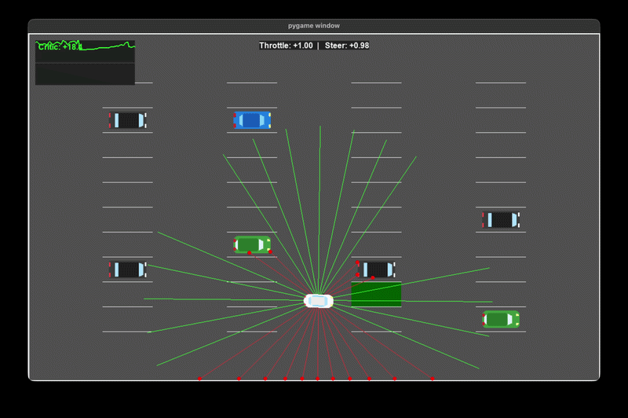
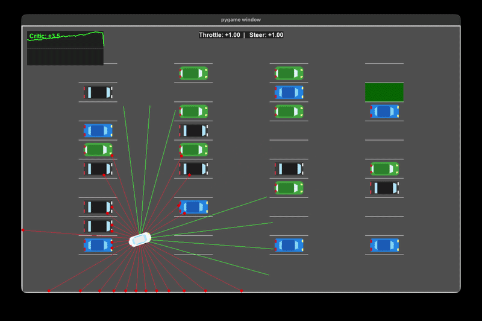
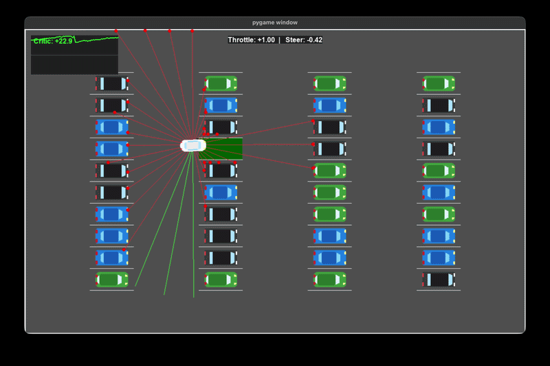

# Autonomous Parking Agent (Reinforcement Learning) 🚗🧠

An end-to-end Deep Reinforcement Learning project that trains an autonomous agent to park a car in complex environments. The project features a custom physics environment, curriculum learning, a heavily optimized PPO architecture, and a production-ready API for inference.

## 🚀 Key Features

- **Custom Physics Environment:** Built from scratch to simulate car kinematics, radar sensors (LIDAR-like rays), and collision detection.
- **Curriculum Learning:** The agent progressively learns to park by advancing through increasing difficulty levels based on success rate and entropy tracking.
- **Optimized PPO Architecture:** Features an asymmetric Actor-Critic MLP network (`pi=[256, 256, 128, 128]`, `vf=[512, 256, 128, 128]`) to effectively handle sparse rewards and filter sensor noise.
- **Production API:** A fully functional REST API built with **FastAPI** to serve model predictions, integrated with **Celery** and **Redis** for asynchronous background processing.

## 🎥 Visualizing the Learning Process

Watch how the agent's behavior evolves over tens of millions of training steps across various difficulty levels:

### Early Stages (Learning the Basics)
- **4 Million Steps (Difficulty Level 0):**
  
  *Agent learns basic acceleration and steering to reach an open spot.*

- **5.5 Million Steps (Difficulty Level 4):**
  
  *Introduction of obstacles. The agent starts learning obstacle avoidance.*

### Mid-Training (Complex Maneuvers)
- **10 Million Steps (Difficulty Level 6):**
  
  *Handling tighter spaces and more complex parking angles.*

### Final Fully-Trained Agent (47 Million Steps)
The final model demonstrates a highly robust parking strategy across all difficulties, achieving a >95% success rate.
<p align="center">
  
  
  
</p>
<p align="center">
  <em>From left to right: Difficulty Level 0, Level 6, and maximum Level 10.</em>
</p>

## 📊 Training Results & Architecture Evolution

Training autonomous agents with sparse rewards required extensive hyperparameter tuning and architecture changes:

1. **Attempt 1 (Initial Architecture - `[256, 256, 128]`):** We started our training experiments using a standard baseline network. However, the agent struggled to associate sparse rewards with complex maneuvers, and training stalled at early difficulty levels.
2. **Attempt 2 (Architecture Search & Asymmetric Networks):** We subsequently tested various other network shapes before settling on a hierarchical asymmetric architecture. The Actor was set to `[256, 256, 128, 128]` to force decisive steering actions, while the Critic was given higher capacity (`[512, 256, 128, 128]`) to better estimate state values.
3. **Exploration Tuning:** We did not rely on any learning rate scheduling. Instead, we successfully overcame local optima by focusing purely on exploration – specifically by increasing the entropy coefficient (`ent_coef=0.005`). This approach allowed the agent to reliably escape dead ends, reaching a **95%+ success rate** on the maximum difficulty level.

### Learning Curves (Final Model)
<p align="center">
  
  
  
</p>
<p align="center">
  <em>From left to right: Average Epoch Reward, Average Episode Length (Steps), and Curriculum Level Progression over training timesteps.</em>
</p>

## 🛠️ Tech Stack

- **Machine Learning:** PyTorch, Stable Baselines3
- **Environment & Visualization:** Pygame, NumPy
- **Deployment (MLOps):** FastAPI, Celery, Redis, Uvicorn

## 💻 Installation & Usage

### 1. Install Dependencies
Create a `requirements.txt` file with the following content:
```text
stable-baselines3>=2.0.0
torch>=2.0.0
gymnasium>=0.28.1
pygame>=2.5.0
numpy>=1.24.0
fastapi>=0.100.0
uvicorn>=0.23.0
celery>=5.3.0
redis>=4.6.0
pydantic>=2.0.0

```

Then run:

```bash
pip install -r requirements.txt

```

### 2. Train a New Agent

```bash
python src/agent/train.py

```

### 3. Run the Inference API

You need two separate terminal instances to run the server and the background worker.

**Terminal 1 (FastAPI Server):**

```bash
uvicorn api.main:app --reload

```

**Terminal 2 (Celery Worker):**
Ensure Redis is running (`docker run -p 6379:6379 -d redis`), then start the worker:

```bash
celery -A api.main.celery_app worker --loglevel=info

```

Access the Swagger UI at `[http://127.0.0.1:8000/docs](http://127.0.0.1:8000/docs)` to test the endpoints.

## 📂 Project Structure

```text
car_parking_rl/
├── api/
│   ├── main.py            # FastAPI application & endpoints
│   ├── schemas.py         # Pydantic models for request/response validation
├── env/
│   ├── parking_env.py     # Gymnasium-compatible RL environment
│   ├── physics.py         # Car kinematics and collision logic
│   └── renderer.py        # Pygame visualizer
├── src/
│   ├── agent/             
│   │   ├── train.py       # PPO training loop with Curriculum Learning
│   │   ├── evaluate.py    # Model evaluation scripts
│   │   └── plot_results.py# Matplotlib curriculum progress charts
├── SavedModels/           # Serialized .zip models for different iterations
├── videos/                # Gifs and visualizations of the agent
└── README.md